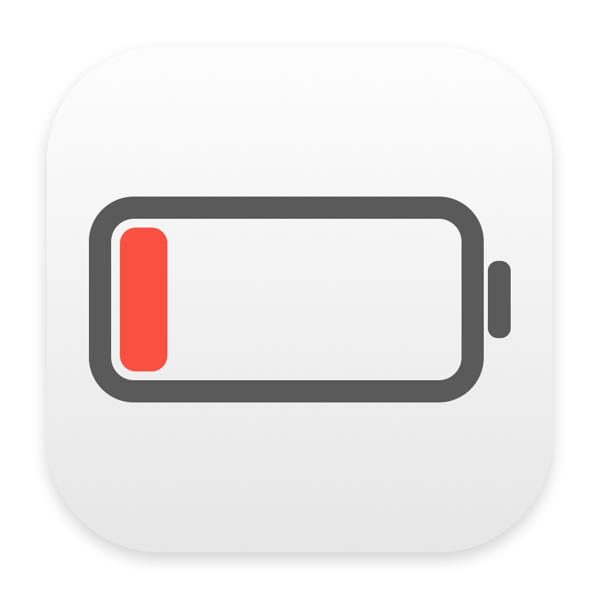

# Battery Alert · 电池提醒



一个轻量的原生 macOS 菜单栏工具，在电量过低前提前提醒你接通电源。默认 **15%** 提醒，使用系统通知横幅和电池图标。

**[下载最新版本](https://github.com/fi5/battery-alert-mac/releases/latest)** · [English](README.en.md)

## 功能

- 提醒阈值可设为 5%–50%，默认 15%。
- 原生系统通知，可开关提示音，无需关闭弹窗。
- 同一轮低电量只提醒一次；连接电源或电量恢复后重新准备提醒。
- 菜单栏显示当前电量、供电状态，并提供测试通知。
- 可选登录时启动；退出后停止监测。
- 中文、英文界面，跟随系统语言。
- 支持 Apple 芯片和 Intel，macOS 13 Ventura 或更新版本。
- 无账号、无联网、无统计；设置与电量数据留在本机。

## 安装

1. 从 [Releases](https://github.com/fi5/battery-alert-mac/releases) 下载 `.dmg`。
2. 打开 DMG，将 **Battery Alert.app** 拖入 **Applications**，再从应用程序打开。
3. 点击菜单栏电池图标，选择「允许通知」。
4. 点击「发送测试通知」，确认横幅能显示；按需开启「登录时启动」。

第一版为临时签名，**尚未经过 Apple 公证**。如系统拦截，请参考 [Apple 关于打开未知开发者 App 的说明](https://support.apple.com/guide/mac-help/open-a-mac-app-from-an-unknown-developer-mh40616/mac)，到系统设置 → 隐私与安全性查看此 App 的「仍要打开」选项。无需关闭系统安全防护。

没有看到通知时，到「系统设置 → 通知 → 电池提醒」开启允许通知并选择「横幅」，同时检查专注模式。程序显示“测试通知已发送”表示系统已接受发送请求，不保证系统设置允许显示横幅。

这是一条额外的低电量提醒，不会修改苹果自带的 10% 提醒，也不会修改充电策略。Mac 睡眠、关机或 App 退出期间不会发送通知；唤醒后会重新检查电量。开启通知权限后，如电脑已经低于阈值，会立即尝试提醒。

## 卸载

先在工具里关闭「登录时启动」，退出程序，再把 App 移到废纸篓。偏好设置保存在 `io.github.batteryalertmac` 的用户偏好域中，不会创建额外的 shell 任务。

## 从源码构建

需要 macOS 及 Xcode Command Line Tools，无第三方库或包下载。

```sh
python3 scripts/test.py
python3 scripts/build.py
python3 scripts/package.py
```

默认构建 `arm64` / `x86_64` 通用 App，DMG、ZIP 及 SHA-256 校验文件在 `dist/`。构建单一架构时可使用 `python3 scripts/build.py --arch arm64`。

打包脚本直接生成文件系统映像并压缩成 DMG，无需挂载临时磁盘。GitHub Actions 会在 macOS runner 上测试、构建和发布发行包。

发布者如配置 Developer ID，可通过 `CODESIGN_IDENTITY` 使用开发者签名；公证步骤见 [发布说明](docs/RELEASING.md)。当前公开构建不包含开发者证书，也不宣称已公证。

## 实现与验证

使用 IOKit 电源事件监测电量，唤醒后重新检查，并以每分钟检查作后备。通知通过 UserNotifications 发送；登录项使用系统 ServiceManagement API。规则测试覆盖阈值边界、去重、跨重启状态、充电恢复、自定义阈值及失败重试。

许可： [MIT](LICENSE)。
